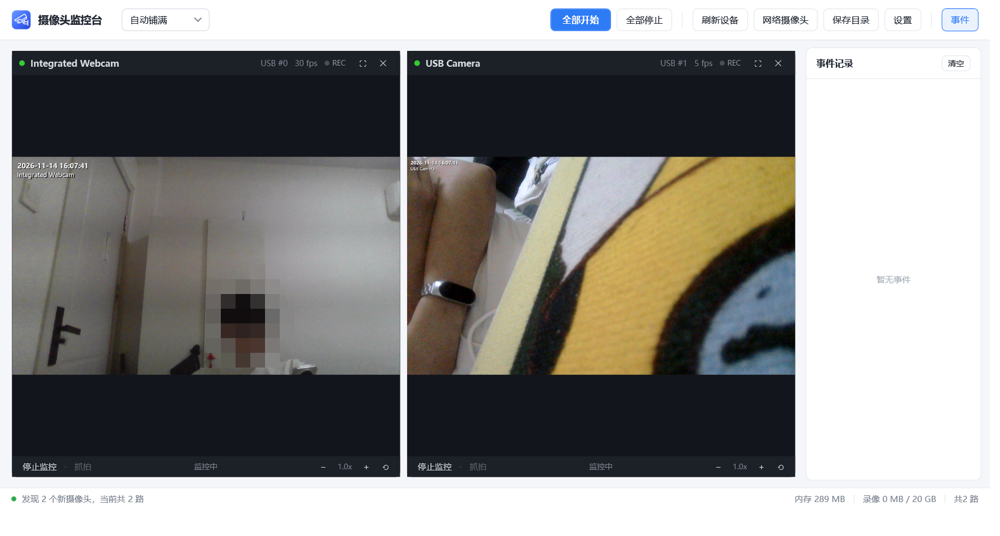

# 摄像头监控台

轻量级多路摄像头监控工具 —— 多路实时预览、运动检测、录像抓拍、企业微信告警。
.NET 10 + WPF + OpenCvSharp4，不依赖 FFmpeg / 数据库 / 前端框架，打包后**一个 exe 就能跑**。



---

## 功能

| 分类 | 能力 |
|------|------|
| 多路预览 | 自动铺满 / 单画面 / 四画面 / 九画面；滚轮缩放（1~8x，以鼠标位置为锚点）、拖拽平移、双击复位 |
| 画面填充 | 「填满」裁掉溢出部分不留黑边（默认）／「适应」完整显示、可能留边，一键切换并记住 |
| 状态一眼可见 | 顶栏红胶囊「录制中 N 路」+ 每路面板红色描边、闪烁 REC 计时；未录像时明确写「监控中 · 录像未开启」 |
| 实测帧率 | 标题栏显示真实出帧数（不是配置值），低于设定 80% 变琥珀色，ToolTip 给出分辨率/编码/后端 |
| 设备接入 | USB / 内置摄像头自动探测并显示真实设备名；支持 RTSP / HTTP / MJPEG 网络摄像头 |
| 虚拟摄像头过滤 | 投屏、会议软件注册的虚拟设备一律不打开，避免误触发「连接手机」类弹窗 |
| 运动检测 | 帧差法 + 降采样，灵敏度 1~100 实时生效，可设置告警冷却 |
| 人脸检测 | Haar 级联画框（只检测，不做身份识别），模型内嵌在 exe 里 |
| 录像 | 全时录制 / 运动触发录制，按摄像头自动分段，MJPG / XVID / MP4V 编码 |
| 截图 | 手动抓拍 + 运动触发自动抓拍，带时间戳水印 |
| 画面叠加 | 时间戳、设备名、自定义水印（`{name}` / `{time}` / `{date}`） |
| 企业微信推送 | 运动触发时推送截图 + 文字，自带冷却时间 |
| 磁盘治理 | 容量上限自动淘汰最旧文件，每日定时清理过期文件 |
| 事件列表 | 右侧时间线，双击直接打开对应截图 |
| 一键启停 | 「全部开始 / 全部停止」真正释放设备并结束录像，停止时面板盖遮罩 |
| 掉线重连 | 连续读帧失败自动重连，指数退避 1s → 15s |
| 单实例 | 防止两个进程抢同一台摄像头导致双双失败 |

**不做的事**（避免期待落空）：人脸身份识别、RTMP/HLS 推流、Web 远程访问、GPU 推理、录像回放图形界面（录像文件用系统播放器打开）。

---

## 目录结构

```
002一款摄像头运动捕捉小工具/
├── CameraMotionCapture.slnx            # 解决方案
├── src/
│   ├── CameraMotionCapture.App/        # WPF 界面层
│   │   ├── Imaging/                    # 采集管线、水印合成
│   │   ├── ViewModels/  Views/         # MVVM
│   │   └── Converters/  Resources/     # 转换器与设计系统 Styles.xaml
│   ├── CameraMotionCapture.Core/       # 业务服务（采集/检测/录像/存储/推送）
│   │   ├── Models/
│   │   └── Services/{Interfaces,Implementations}/
│   └── CameraMotionCapture.Shared/     # 常量、枚举、工具
├── assets/                             # 品牌资源：图标源文件 / ico / 界面角标 / 截图
├── models/                             # OpenCV 模型（编译时内嵌进程序集）
└── dist/                               # 发布产物（不入版本库）
```

---

## 架构

### 采集管线

每路摄像头一条独立管线，UI 线程只负责把最新一帧贴到屏幕上：

```
采集线程 ──▶ 运动检测（降采样）──▶ 人脸检测（限频 5fps）──▶ 水印合成
                                                        ──▶ 录像写盘
                                                        ──▶ 共享 BGRA 缓冲
                                                                 │
UI 线程（30fps 渲染定时器）◀───────────────────────────────────┘
   只做：WriteableBitmap.Lock → 拷最新帧 → AddDirtyRect → Unlock
```

几条关键取舍：

- **处理不过来就丢帧**，只保留最新一帧，延迟不会累积；
- **运动检测先于水印合成**，否则每秒变化的时间戳会把自己判定成运动；
- **水印图层按内容签名缓存**，时间戳每秒才重绘一次，而不是每帧走一遍 GDI+；
- **停采走代际号 + 强制重开设备**：两代采集线程同时持有一台摄像头时，DirectShow 会卡在 `Read()` 里不出帧，表现为「停止后再开始永久黑屏」。

### 设备枚举

经 DirectShow COM（`ICreateDevEnum` + `IPropertyBag`）读取 `FriendlyName` / `DevicePath`，按 `@device:sw:` 前缀判定虚拟设备并过滤。MSMF 索引空间与 DSHOW 不一致，且每次 `Set` 要 1.5~3.7 秒，因此固定优先 DSHOW、失败才兜底。设备探测串行执行 —— 并发打开会让物理摄像头读帧失败。

---

## 技术栈

| 技术 | 用途 |
|------|------|
| .NET 10 / WPF | 桌面应用 |
| OpenCvSharp4 | 采集、图像处理、视频编码 |
| Microsoft.Extensions.DependencyInjection | 依赖注入 |
| Serilog | 文件日志（按天滚动，保留 14 天） |
| Ookii.Dialogs.Wpf | 文件夹选择 |
| System.Drawing (GDI+) | 中文水印渲染 |

---

## 快速开始

### 环境要求

- Windows 10 / 11 x64
- .NET 10 SDK（仅编译需要，发布版自带运行时）
- USB 摄像头或 RTSP 网络摄像头

### 编译运行

```bash
dotnet restore
dotnet run --project src/CameraMotionCapture.App
```

### 打包单文件 exe

```powershell
powershell -ExecutionPolicy Bypass -File .\publish.ps1   # 产物：dist\摄像头监控台.exe
```

等价的手工命令：

```bash
dotnet publish src/CameraMotionCapture.App -c Release -r win-x64 --self-contained \
  -p:PublishSingleFile=true -p:IncludeNativeLibrariesForSelfExtract=true \
  -p:EnableCompressionInSingleFile=true -o dist
```

自包含单文件约 110 MB，目标机器无需安装 .NET。人脸模型已内嵌，首次使用时会释放到
`%LOCALAPPDATA%\摄像头监控台\models\`；若想换模型，把同名 xml 放到 exe 旁边即可覆盖。

---

## 使用

### 快捷键

| 按键 | 功能 |
|------|------|
| `F11` | 当前画面全屏 / 退出全屏 |
| `Esc` | 退出全屏 |
| `F5` | 重新探测摄像头 |
| `Ctrl+O` | 打开保存目录 |
| 鼠标滚轮 | 缩放画面 |
| 双击画面 | 缩放复位 |

### 配置

配置保存在程序目录下的 `appsettings.json`，全部通过「设置」界面修改：

| 分组 | 可配置项 |
|------|---------|
| 采集 | 后端（自动 / DSHOW / MSMF）、分辨率（默认 1920×1080）、帧率（默认 30，可选 10~60）、硬件加速 |
| 录像 | 开关、模式（全时 / 运动触发）、编码、分段时长、事件录制时长、容量上限、保留天数、按天分目录 |
| 检测 | 运动检测开关与灵敏度、告警冷却、运动自动截图、人脸检测开关 |
| 叠加 | 时间戳、设备名、自定义水印 |
| 通知 | 企业微信 Webhook |

> 录像默认**关闭**。开启后请务必设置「容量上限」，否则长时间运行会持续吃磁盘。

### 输出结构

```
recordings/
├── 2026-11-14/
│   └── rec_cam0_20261114_143355.avi             # 录像：前缀 + 摄像头编号 + 时间戳
└── snapshots/2026-11-14/
    ├── motion_cam1_20261114_143401_233.jpg      # 运动触发抓拍
    └── manual_cam0_20261114_143520_119.jpg      # 手动截图
```

运行日志在程序目录 `logs/app-20261114.log`，按天滚动、保留 14 天。

---

## 常见问题

**为什么插着手机/装了投屏软件却没被识别成摄像头？**
虚拟设备（如 vivo 办公套件、OBS 虚拟摄像头）会被主动过滤。打开它们会拉起手机连接流程，且画面源并不可控，所以不做支持。

**启动后要等几秒才出画面？**
设备探测是串行的，每台摄像头都要真正读到一帧才算可用，两路设备通常在 5~8 秒内完成。

**为什么设了 30fps，显示只有 16fps？**
帧率显示的是**真实出帧数**。1080p 未压缩（YUY2）在 USB 2.0 上只能跑 5~10fps，所以程序会强制把 MJPG 协商上（这一步实测必须放在设置分辨率和帧率**之后**，顺序反了驱动会死守 YUY2）。如果已经协商到 MJPG 还是偏低，剩下两个原因：
① **暗光**——自动曝光会拉长曝光时间，夜里 1080p 常见 15~17fps，开灯就回到 30；
② **设备/后端限制**——可在设置里把「采集后端」改成 Media Foundation 试试（部分 USB 摄像头能多跑一截，代价是每次打开慢 5~10 秒）。

**状态栏的「内存」是什么？**
程序自身工作集（采集缓冲 + 解码 + 界面），每 2 秒刷新；旁边的「录像」才是磁盘占用，每 10 秒刷新。

**画面为什么有黑边？**
预览按等比缩放（Uniform），画布与摄像头宽高比不一致时留黑边，不做裁切拉伸。

---

## 路线图

- [ ] 运动事件 pre-roll 环形缓冲（回溯事件前 N 秒）
- [ ] 录像回放界面（时间轴 + 事件跳转）
- [ ] 区域入侵检测（ROI 掩码）
- [ ] YuNet 替换 Haar 人脸检测
