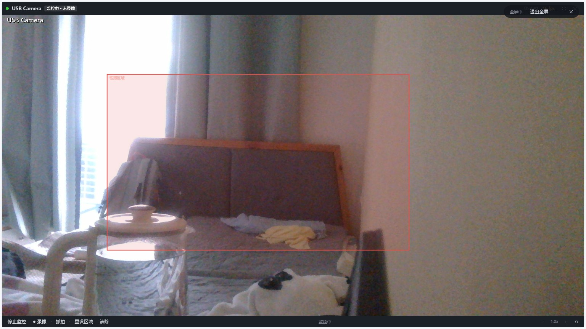
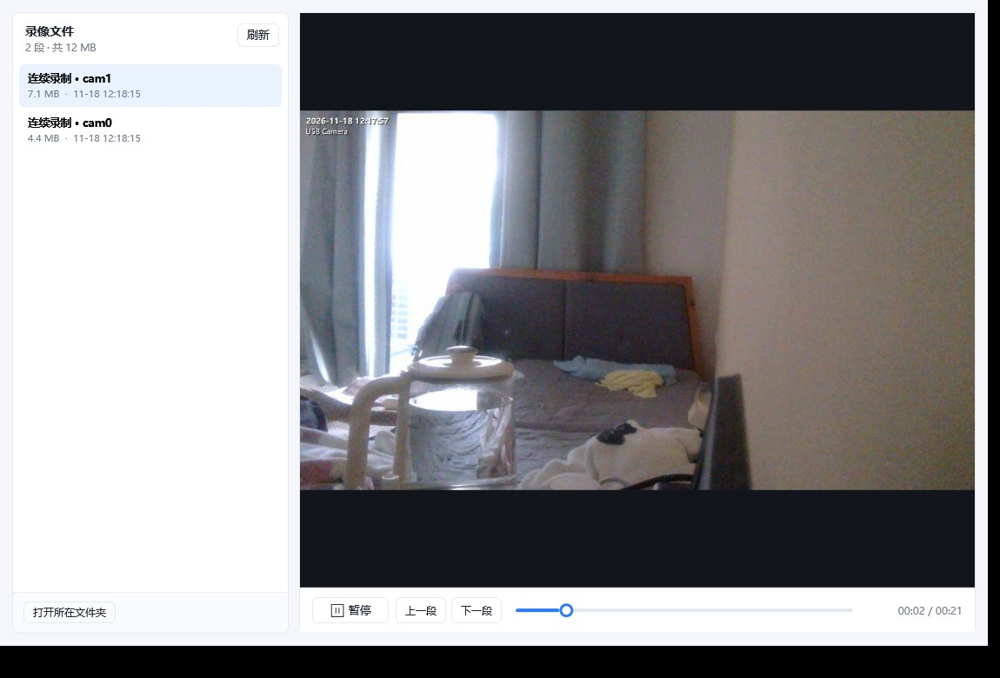
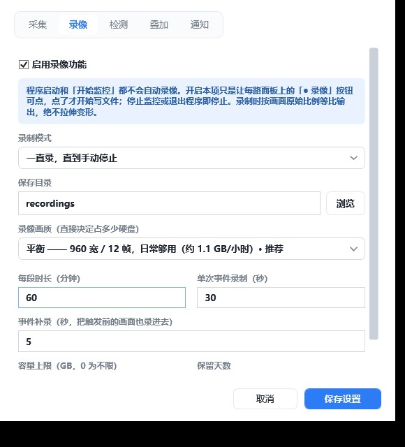

# 摄像头监控台

**多路摄像头实时监看工具** —— 插上就能看，点一下才录，录完能在程序里直接回放。绿色单文件，不用装运行库、不用注册账号、不用连任何服务器。


> 为保护隐私，截图中的人物画面已做打码处理。

---

## 它适合谁

家里、店里、仓库、机房、宠物窝 —— 想随时看一眼摄像头，又不想被复杂的管理平台绑住的人。

把摄像头接上、打开程序就能看到画面；需要留证据的时候点一下「录像」，文件老老实实存在本机硬盘里。不联网、不上传、不调用任何云端服务，画面和数据都留在自己电脑上。

---

## 一眼看懂

| 你关心的 | 它的做法 |
|---|---|
| **同时看多路** | USB 摄像头、笔记本内置摄像头、RTSP / HTTP 网络摄像头都能接；自动铺满、单画面、四画面、九画面自由切换 |
| **看得清细节** | 滚轮放大到 8 倍、按住拖拽平移、双击复位；画面按原始比例缩放，永远不会被拉扁变形 |
| **全屏后不会"困住"** | 全屏时右上角始终留一枚浮层：**退出全屏 · 最小化 · 关闭**，鼠标一动就亮，不会找不到出口 |
| **只在需要时录** | 启动程序、开始监控都不会自己录。点「● 录像」才开始写文件，再点一次就停 |
| **录像不占满硬盘** | 三档画质可选，最省的一档 12 小时约 3.7 GB；还能设容量上限和保留天数，超了自动清理最旧的 |
| **找录像不用翻文件夹** | 程序内置「录像库」：按时间列出所有片段，选中就能播，上一段 / 下一段直接切 |
| **只关心要紧的地方** | 在画面上框一块「检测区域」，只有框里有动静才算数 —— 门口、柜台、走廊尽头，其余画面里的风吹草动一律忽略 |
| **事前几秒也录下来** | 「事件补录」把触发前的几秒补进文件开头，人从画面里走过去，前后都留得住 |
| **有动静就通知** | 检测到运动自动截图并推送到企业微信，带冷却时间，不会被刷屏 |
| **掉线自己接回来** | 摄像头被拔、被别的软件抢走、网络抖动，程序会自己重连，面板上直接显示还有几秒重试 |
| **一眼看出在不在录** | 顶栏红胶囊「录制中 N 路」、每路面板红色描边 + 闪烁计时；没录时明确写「监控中 · 未录像」，绝不含糊 |

---

## 界面

### 一屏看住所有画面

左边是多路画面，右边是事件时间线。每路面板顶部写清设备名和实测帧率，右上角红点显示这一路已经录了多久；底部一整条是这一路的操作：停止监控、录像、抓拍、框选区域、缩放。

画面里的**红色框**就是「检测区域」—— 只有框里发生的动静才算数，框外走过去的人、晃动的窗帘一律忽略。

### 全屏单路：右上角永远留得住出口



按 `F11` 或点面板右上角的加号放大到全屏。全屏时顶栏和状态栏自动收起，画面真正铺满整块屏幕，**右上角浮着一枚小浮层：全屏中 · 退出全屏 · 最小化 · 关闭**。鼠标静止 2 秒后浮层会淡下去，但不会消失，随时可以点；按 `Esc` 也能退出。

### 录像库：不用离开程序就能回看



顶栏点「录像库」打开。左边是所有录好的片段，写着类型、大小、时间；右边直接播放，支持上一段 / 下一段、拖动进度条、`空格` 播放暂停、`←` `→` 前后 5 秒。

画面左上角的时间戳是录像时**烧进画面**的 —— 换个播放器、截个图、发给别人，时间都在。录的是标准视频文件，用系统播放器、剪辑软件也能直接打开。

### 录像画质：占多少空间自己定



设置 → 录像。三档画质对应三种"清晰度 × 空间"的取舍，随时可换；只影响之后录的片段，已有文件不受影响。

---

## 录像要占多少硬盘

以 1080p 摄像头、画面持续有明显动作为例（画面越静止，占用越低）：

| 画质 | 画面 | 每小时 | 连续 12 小时 | 什么时候选它 |
|---|---|---|---|---|
| **高清** | 原始分辨率、原始帧率 | ≈ 7.3 GB | ≈ 88 GB | 要看清楚人脸、车牌、货品细节，硬盘管够 |
| **平衡**（默认） | 960 宽 / 12 帧 | ≈ 1.1 GB | ≈ 13 GB | 日常值班回看：认得出人、看得懂发生了什么 |
| **省空间** | 640 宽 / 8 帧 | ≈ 0.3 GB | ≈ 3.7 GB | 只需要知道"有没有人、几点来过"，硬盘小、要存很久 |

几条配套的保护措施，建议一起用上：

- **按小时切片**：每 60 分钟另起一个文件（可在设置里改），找录像时直接按时间点翻，某个文件损坏也不会整晚的录像全丢；
- **容量上限**：写满设定值就自动删最旧的，默认 20 GB，长期挂着不用管；
- **保留天数**：超过天数的自动清理，默认 7 天；
- **按日期分文件夹**：一天的录像一个文件夹，拷走、归档都方便。

---

## 三步开始

1. **接上摄像头，打开程序** —— 几秒内自动识别并开始预览（插着手机、装了投屏软件也不会误弹窗）。
2. **点「● 全部录像」**（或某一路面板上的「● 录像」）开始录 —— 不点就不会录，这是故意的。
3. **要看录像就点「录像库」** —— 选中片段直接播放，或点「打开所在文件夹」用系统播放器看。

---

## 常用操作

| 操作 | 怎么做 |
|---|---|
| 全屏 / 退出全屏 | `F11`；全屏后右上角浮层里也有「退出全屏」，或按 `Esc` |
| 放大看细节 | 鼠标滚轮（以鼠标位置为中心放大），按住左键拖拽平移，双击复位 |
| 框选检测区域 | 点面板底部「框选区域」→ 在画面上按住左键拖出一个框 → 点「完成框选」；「重设区域」可重来，「清除」恢复全画面 |
| 回放录像 | 顶栏「录像库」→ 选片段 → `空格` 播放暂停、`←` `→` 前后 5 秒、`Esc` 关闭 |
| 重新探测摄像头 | `F5`（刚插上设备、或设备名变了的时候用） |
| 打开保存目录 | `Ctrl+O` |
| 画面填满 / 适应 | 顶栏「画面」按钮：填满 = 不留黑边（默认），适应 = 完整显示、可能留边 |

---

## 设置项

全部设置都在顶栏「设置」里，按分组排列：

| 分组 | 能改什么 |
|---|---|
| 采集 | 分辨率（默认 1920×1080）、帧率（默认 30）、采集后端、硬件加速 |
| 录像 | 录像开关、录制模式（一直录 / 布防后仅运动时录）、保存目录、**画质三档**、**每段时长**、单次事件时长、**事件补录秒数**、容量上限、保留天数、按日期分文件夹 |
| 检测 | 运动检测开关与灵敏度、告警冷却、运动自动抓拍、人脸检测 |
| 叠加 | 时间戳、设备名、自定义水印（支持 `{name}` `{time}` `{date}`） |
| 通知 | 企业微信机器人 Webhook 地址 |

---

## 文件存在哪

默认都在程序目录下（保存目录可在设置里改）：

```
recordings/
├── 2026-11-14/
│   ├── rec_cam0_20261114_090000.avi      # 摄像头 0 的连续录像，每小时一段
│   └── rec_cam0_20261114_100000.avi
└── snapshots/2026-11-14/
    ├── motion_cam1_20261114_143401_233.jpg   # 检测到运动自动抓拍
    └── manual_cam0_20261114_143520_119.jpg   # 手动点「抓拍」
```

运行日志在同目录 `logs/`，按天生成、保留 14 天，反馈问题时可一并提供。

---

## 常见问题

**为什么程序启动后不自动录像？**
故意的。没人看着的时候自动开录，很容易把硬盘写满还察觉不到。要录就点一下，录的时候顶栏和面板都会红着提示。

**为什么不是一整晚一个文件？**
按小时切片更好用：想找凌晨 3 点发生的事，直接点 3 点那个文件；某一段损坏也不会连带整晚。切片时长在设置里可以改。

**画面为什么有黑边？**
顶栏「画面」按钮可在「填满 / 适应」之间切换。填满是默认：等比放大到盖满面板、多余部分裁掉，不留黑边；适应则完整显示整个画面，比例不一致时留边。两种模式都不会把画面拉变形。

**设了 30 帧，为什么显示只有 16 帧？**
面板上显示的是**真实出帧数**，不是设置值。常见原因有两个：一是光线太暗，摄像头会拉长曝光时间，晚上 1080p 常掉到 15 帧左右，开灯就回来了；二是这台摄像头在电脑上能拿到的带宽有限，把分辨率降到 720p 或把帧率设成 20 会稳定很多。

**磁盘写满了会怎样？**
设置了「容量上限」，写满就自动删最旧的录像；「保留天数」到期的也会清掉。两个都不设等于不限，长时间挂着请务必设一个。

**摄像头被拔了 / 被别的软件占用了怎么办？**
程序会自己重连，面板上显示「N 秒后重试」，恢复正常就说明接上了。一直连不上时，插好设备后按 `F5` 重新探测。

**检测区域有什么用？**
比如摄像头对着整间屋子，但你只关心门口那一小块：框住门口，屋里其他地方的动静、宠物走动都不会触发录像和告警。区域按摄像头分别保存，下次打开还在。

**录像发给别人会带出什么信息？**
只有画面本身，以及烧进画面的时间戳、设备名和自定义水印。没有账号、没有机器信息、不含任何云端链接。

---

## 暂不支持

说清边界，免得期待落空：

- 人脸**身份识别**（画面上会标出人脸位置，但不认识具体是谁）
- 云端存储、手机远程访问、多人同时观看
- 推流到直播平台（RTMP / HLS）
- 音频录制（只录画面）
- 手机 App

---

## 关于

- 版本 **2.5.0**，支持 Windows 10 / 11（64 位）
- 绿色单文件，解压即用：`dist/摄像头监控台.exe`，目标机器无需安装任何运行库
- 源码编译与打包脚本见仓库内 `publish.ps1` 与 `src/`
