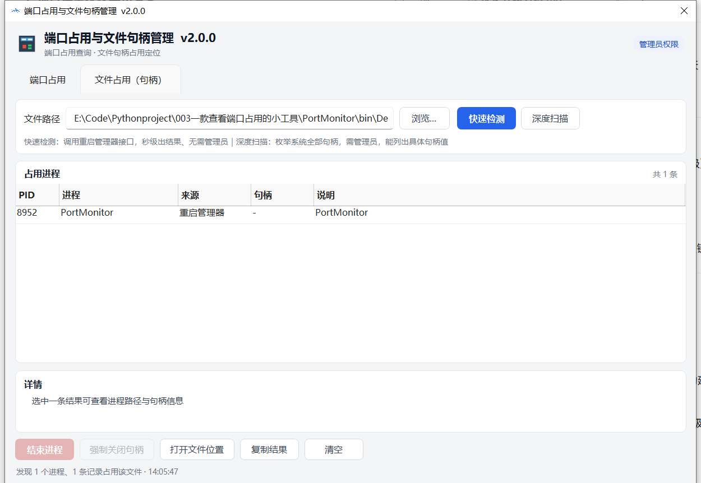

# 端口占用与文件句柄管理

> 版本：v2.0 | 架构：.NET 10 WPF + MVVM | 平台：Windows 10 / 11 (x64)

基于 **C# / .NET 10 WPF** 的 Windows 桌面工具：一边查端口被谁占了，一边查文件被谁锁着。
端口侧通过 P/Invoke 调用 `iphlpapi.dll` 枚举 TCP/UDP 连接表（IPv4 + IPv6）；文件侧通过
**重启管理器（Restart Manager）** 与 **NT 句柄枚举** 双重定位占用进程，并支持结束进程或强制关闭句柄。




---

## 功能特性

### 一、端口占用

| 功能 | 说明 |
|------|------|
| **端口查询** | 输入端口号，查询占用该端口的 TCP/UDP 连接，**IPv4 + IPv6 双栈**全覆盖 |
| **协议筛选** | 全部 / TCP / UDP |
| **状态着色** | LISTEN 绿、ESTABLISHED 蓝、TIME_WAIT 灰，一眼分辨 |
| **进程详情** | PID、进程名、协议、状态、本地地址、远端地址 |
| **命令行查看** | 选中行后按需读取完整命令行（不再阻塞查询） |
| **常用端口** | 3000 / 3306 / 5173 / 6379 / 8080 / 9090 / 8848 一键查询 |
| **自动刷新** | 2 秒刷新，**刷新时保留当前选中行**，不再闪屏 |
| **结束进程** | 先请求正常退出，2.5 秒无响应再强制结束；系统关键进程禁止操作 |
| **复制能力** | 复制 PID / 命令行 / 全部结果（带表头对齐） |
| **定位进程** | 在资源管理器中选中该进程的可执行文件 |

### 二、文件占用（句柄）

> 场景：删除 / 重命名 / 移动文件时提示“文件正在被另一个程序使用”，但不知道是哪个程序。

| 功能 | 说明 |
|------|------|
| **快速检测** | 调用重启管理器接口（`rstrtmgr.dll`），秒级出结果，**无需管理员** |
| **深度扫描** | `NtQuerySystemInformation` 枚举全系统句柄，逐个比对对象路径，能列出**具体句柄值**；需管理员 |
| **双击场景** | 两种方式结果自动合并：重启管理器给出应用/服务名，句柄扫描补上句柄明细 |
| **结束进程** | 最稳妥的解法：让占用文件的程序退出（带保护名单） |
| **强制关闭句柄** | `DUPLICATE_CLOSE_SOURCE` 直接抽掉对方手里的句柄（高风险，会二次确认） |
| **文件 / 文件夹** | 支持定位单个文件，也支持扫描整个文件夹内被占用的文件 |
| **打开位置** | 在资源管理器中定位到该文件 |

---

## 系统架构

```
PortMonitor/
├── PortMonitor.slnx                  # 解决方案（单项目）
├── PortMonitor.csproj                # 项目文件（net10.0-windows）
├── app.manifest                      # asInvoker + PerMonitorV2 DPI + 长路径
├── App.xaml / App.xaml.cs            # 入口、Fluent 主题、全局异常兜底
├── MainWindow.xaml / .xaml.cs        # 主窗口（固定尺寸，两个功能页）
├── Converters.cs                     # 值转换器（颜色 / 可见性 / 空串占位）
├── Models/
│   ├── ConnectionInfo.cs             # 端口连接模型
│   ├── FileLockInfo.cs               # 文件占用模型（含句柄值）
│   └── ProtocolFilter.cs             # 协议筛选枚举
├── Services/
│   ├── NativeMethods.cs              # 全部 P/Invoke 声明集中处
│   ├── PortService.cs                # TCP/UDP 连接表枚举（IPv4 + IPv6）
│   ├── ProcessInfoService.cs         # 批量进程快照 + 按需命令行 + 结束进程
│   ├── FileLockService.cs            # 重启管理器 + NT 句柄扫描 + 关闭句柄
│   ├── ElevationService.cs           # 管理员检测与提权重启
│   └── Dialogs.cs                    # 对话框封装
├── ViewModels/
│   ├── ObservableObject.cs           # INotifyPropertyChanged 基类
│   ├── RelayCommand.cs               # RelayCommand / AsyncRelayCommand
│   ├── PortViewModel.cs              # 端口页
│   ├── FileLockViewModel.cs          # 文件句柄页
│   └── MainViewModel.cs              # 主视图模型（聚合 + 权限状态）
├── Resources/
│   ├── Styles.xaml                   # 卡片 / 按钮 / 胶囊样式
│   ├── app_icon.ico                  # EXE 多分辨率图标
│   └── app_icon.png                  # 窗口图标
├── images/                           # 截图
└── README.MD
```

### 设计要点

- **MVVM 解耦**：View 只做绑定，业务逻辑全在 ViewModel / Service；无事件转发式 code-behind。
- **P/Invoke 优先于 WMI**：`GetExtendedTcpTable` 一次拿到含 PID 的全表，比 `wmic` / `netstat` 文本解析快且稳。
- **进程信息批量化**：一次 `Process.GetProcesses()` 拿全表进程名（实测 ~11ms），替代“每条连接一次 WMI 查询”（实测 ~72ms/次）。
- **按需查询命令行**：仅当用户选中某一行时才查（单次 ~70ms），去掉了 O(N) 的批量开销。
- **异步不阻塞 UI**：查询、结束进程、句柄扫描都在后台线程，UI 线程只负责渲染。
- **增量刷新**：端口结果只在数据真正变化时重建集合，并按稳定键恢复选中行，避免闪烁与选中丢失。

---

## 技术栈

| 技术 | 用途 |
|------|------|
| .NET 10 / WPF | 桌面应用框架，Fluent 主题（`ThemeMode="System"`） |
| iphlpapi.dll（P/Invoke） | `GetExtendedTcpTable` / `GetExtendedUdpTable` 获取连接表 |
| ntdll.dll（P/Invoke） | `NtQuerySystemInformation` 枚举句柄、`NtQueryObject` 取对象名 |
| rstrtmgr.dll（P/Invoke） | 重启管理器定位文件占用进程 |
| kernel32.dll（P/Invoke） | `DuplicateHandle` 复制/关闭远程句柄、`GetFileType` 过滤管道 |
| System.Management (WMI) | 仅用于按需查询进程命令行 |

---

## 快速开始

### 环境要求

- Windows 10 / 11（64 位）
- .NET 10 SDK

### 编译运行

```bash
cd PortMonitor

# 编译（解决方案与项目都在这一层）
dotnet build PortMonitor.slnx

# 运行
dotnet run --project PortMonitor.csproj
```

> v1.0 的 README 写的是 `src/PortMonitor/...`，与实际目录不符、命令跑不通，v2.0 已修正。

### 打包为 exe

```bash
# 方式一：自包含单文件（约 62MB，免装运行时，双击即用）
dotnet publish PortMonitor.csproj -c Release -r win-x64 --self-contained true ^
  -p:PublishSingleFile=true -p:EnableCompressionInSingleFile=true ^
  -p:IncludeNativeLibrariesForSelfExtract=true -o ..\dist

# 方式二：依赖运行时（约 2-3MB，需安装 .NET 10 Desktop Runtime）
dotnet publish PortMonitor.csproj -c Release -r win-x64 --self-contained false -o ..\dist-fx
```

---

## 使用说明

### 端口查询

1. 输入端口号（0-65535），选择协议，点击「检查端口」或按 **Enter**
2. 点击「常用端口」里的胶囊可一键查询
3. 选中某一行 → 下方显示该进程完整命令行（首次读取约 70ms）
4. 「结束进程」先尝试正常退出，超时才强制结束

### 文件占用定位

1. 找到删不掉的那个文件的完整路径（可在资源管理器地址栏复制）
2. 粘贴到「文件路径」→ 点「快速检测」（日常够用，秒出结果）
3. 快速检测没找到？点「深度扫描」（需管理员，会枚举全系统句柄）
4. 定位到进程后，优先「结束进程」；确认无风险时才用「强制关闭句柄」

### 权限

| 操作 | 普通权限 | 管理员权限 |
|------|:---:|:---:|
| 查询端口 / 命令行 | ✅ | ✅ |
| 结束自己启动的进程 | ✅ | ✅ |
| 结束系统级进程 | ❌ | ✅ |
| 快速检测文件占用 | ✅ | ✅ |
| 深度扫描句柄 | ❌ | ✅ |
| 强制关闭句柄 | ❌ | ✅ |

程序默认以 `asInvoker` 启动（双击即用），需要提权时点右上角「以管理员身份重启」，会弹 UAC 并自动重开。

### 快捷键

- **Enter**：在端口输入框 / 路径输入框中执行查询

---

## 安全设计

- **系统进程保护名单**：`csrss`、`wininit`、`lsass`、`svchost`、`services`、`explorer`、`dwm`、`winlogon` 等一律禁止结束；PID ≤ 4 直接拦截。误杀这些进程会导致蓝屏或强制重启。
- **不默认杀进程树**：`Kill(entireProcessTree: false)`，避免连带杀掉由启动器托管的其它进程。
- **优雅退出优先**：先 `CloseMainWindow()`，2.5 秒不退再强杀，降低丢未保存数据的概率。
- **关闭句柄双重确认**：明确告知“可能导致目标程序崩溃或丢数据”，并建议优先结束进程。
- **管道规避**：句柄扫描先用 `GetFileType` 过滤出磁盘文件句柄，再做 `NtQueryObject`，避免同步命名管道导致卡死。

---

## v2.0 更新日志

### 修复

1. **端口 ≥ 32768 查不到（严重）**
   原实现 `(int)IPAddress.NetworkToHostOrder((short)raw)` 中 `(short)` 截断会让高端口解析成负数，
   与用户输入永不相等，于是把“已占用”误判为“空闲”。实测对照：

   | 端口 | 原实现 | 现实现 |
   |---|:---:|:---:|
   | 8080 | 8080 ✅ | 8080 ✅ |
   | 32767 | 32767 ✅ | 32767 ✅ |
   | 32768 | **-32768** ❌ | 32768 ✅ |
   | 49152 | **-16384** ❌ | 49152 ✅ |
   | 65535 | **-1** ❌ | 65535 ✅ |

2. **解决方案与文档构建路径失效**：`PortMonitor.slnx` 指向不存在的 `src/PortMonitor/`，`dotnet build PortMonitor.slnx` 报 `MSB3202`；README 命令同样跑不通。
3. **缺少 IPv6**：所有枚举写死 `AF_INET`，导致只监听 `[::]` 的服务（Node / Vite / Python 常见）查不到。
4. **查询性能**：每条连接一次 WMI 查询（~72ms/次），连接多时秒级卡顿 → 改为批量快照 + 按需命令行。
5. **自动刷新吞掉选中行**：每次刷新 `Clear()` 集合导致选中丢失、按钮变灰 → 改为差异判断 + 按稳定键恢复选中。
6. **重启管理器结构体对齐错误**：`RM_PROCESS_INFO` 在 `Pack=4` + `CharSet=Unicode` 下才是正确的 668 字节，
   否则进程名读出乱码且不报错（v2.0 开发中实测发现并修复，已留断言探针）。
7. **版本号硬编码**：标题里的 `v1.0` 改为读取程序集版本。
8. **调试符号**：`DebugType=none` 仅在 Release 生效，Debug 保留 pdb。

### 新增

- 文件占用（句柄）定位页：重启管理器 + 深度句柄扫描 + 强制关闭句柄
- 管理员权限检测、一键提权重启、`app.manifest`（PerMonitorV2 DPI、长路径）
- 系统关键进程保护名单、优雅结束进程
- 常用端口胶囊、复制全部结果、打开进程位置
- 全局异常兜底（不再静默崩溃）
- Fluent 主题（跟随系统深浅色）、固定窗口尺寸、状态着色、斑马纹
- 窗口标题、状态栏与权限徽标

---

## 已知限制

- **重启管理器**受 `MAX_PATH` 限制（路径 ≥ 260 字符时自动跳过），此类路径请用深度扫描。
- **深度扫描**默认 25 秒超时，超大系统（数万句柄）可能只返回部分结果。
- **强制关闭句柄**属于非常规手段：目标程序后续访问该句柄可能抛异常甚至崩溃，请优先结束进程。
- 部分受保护进程（如杀软自保护、系统服务）即便以管理员身份也无法读取命令行或关闭句柄。
- IPv6 链路本地地址带 `%scope-id` 后缀（如 `[fe80::1%12]:8080`），属正常表现。
- 暂不支持端口段扫描、结果导出、进程树展示（见后续计划）。

## 后续计划

- [ ] 全端口总览（按进程聚合，突破“必须先知道端口号”的限制）
- [ ] 端口段扫描（8000-8100）与结果导出（CSV / JSON）
- [ ] 端口监听告警（端口被占用时通知）
- [ ] 服务抽象化（`IConnectionProvider`）+ 单元测试工程
- [ ] 多语言支持
