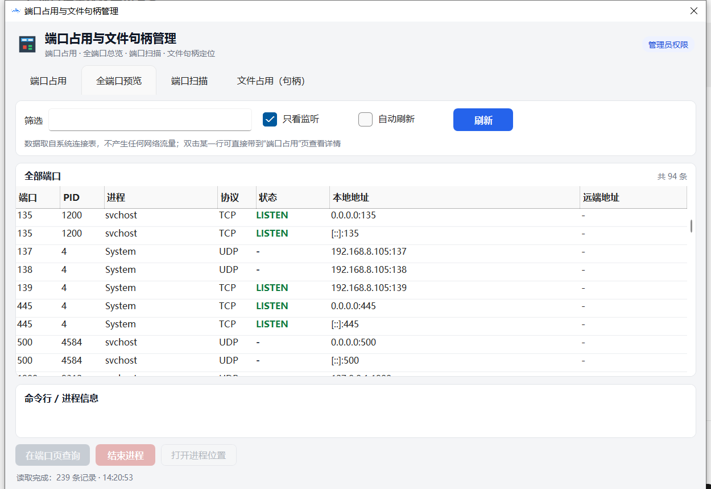
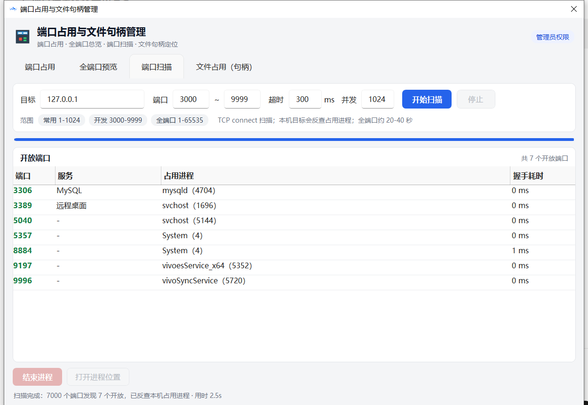
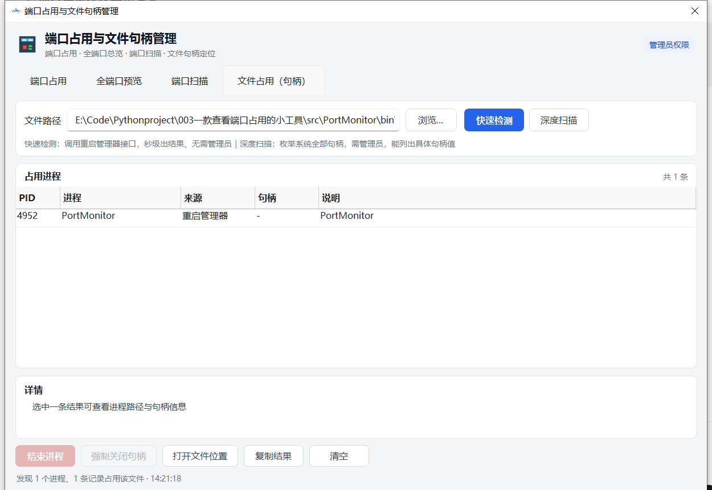

# 端口占用与文件句柄管理

> Windows 桌面工具 · C# / .NET 10 WPF / MVVM · x64

一个把「端口排查」和「文件占用排查」放在同一个窗口里的小工具：谁占了端口、谁锁了文件，选中即可结束进程、打开进程位置或强制关闭句柄。


## 功能

| 页面 | 用途 | 主要能力 |
|------|------|----------|
| **端口占用** | 已知端口号时精确排查 | IPv4 + IPv6 双栈查询、协议筛选、状态着色、命令行查看、常用端口一键查询、2 秒自动刷新（保留选中行） |
| **全端口预览** | 不知道端口号时总览全局 | 一次读取系统全部连接表、按端口 / PID / 进程 / 地址实时筛选、只看监听、3 秒自动刷新、双击跳到端口页 |
| **端口扫描** | 确认某段端口到底开没开 | TCP connect 扫描指定主机与端口区间、可中断、实时进度、常见服务名推测、本机目标自动反查占用进程 |
| **文件占用（句柄）** | 删除文件提示“被占用” | 重启管理器快速检测（免管理员）、NT 句柄深度扫描（列出具体句柄值）、结束进程、强制关闭句柄 |

<table>
  <tr>
    <td></td>
    <td></td>
  </tr>
  <tr>
    <td></td>
    <td></td>
  </tr>
</table>

## 快速开始

### 直接运行

双击 `dist/PortMonitor.exe` 即可。自包含单文件，目标机器无需预装 .NET 运行时。

### 源码构建

需要 Windows 10 / 11（64 位）与 .NET 10 SDK。

```bash
# 在项目根目录（003一款查看端口占用的小工具）执行
dotnet build PortMonitor.slnx
dotnet run --project src/PortMonitor/PortMonitor.csproj
```

### 打包单文件

```bash
dotnet publish src/PortMonitor/PortMonitor.csproj -c Release -r win-x64 \
  --self-contained true -p:PublishSingleFile=true \
  -p:EnableCompressionInSingleFile=true \
  -p:IncludeNativeLibrariesForSelfExtract=true -o dist
```

## 典型场景

**1. 启动服务报「端口已被占用」**
打开「端口占用」页输入端口号 → 回车，直接看到 PID、进程名和完整命令行，判断是不是上一次没退干净的服务，必要时一键结束。

**2. 不知道是谁占了 8080**
打开「全端口预览」，勾选「只看监听」，在筛选框里输入 `8080` 或进程名；想进一步看连接明细就双击该行，自动跳转到端口页。

**3. 删除文件提示「文件正在被另一个程序使用」**
把文件完整路径粘到「文件占用（句柄）」页 → 点「快速检测」（秒级、免管理员）。没找到再点「深度扫描」（需管理员）。定位到进程后优先结束进程；确认无风险才用「强制关闭句柄」。

## 项目结构

```
003一款查看端口占用的小工具/
├── PortMonitor.slnx                 # 解决方案入口
├── README.md
├── dist/                            # 发布产物（自包含单文件 exe）
├── images/                          # 界面截图
└── src/PortMonitor/
    ├── PortMonitor.csproj           # net10.0-windows / WPF
    ├── app.manifest                 # asInvoker + PerMonitorV2 DPI + 长路径
    ├── App.xaml(.cs)                # 入口、Fluent 主题、全局异常兜底
    ├── MainWindow.xaml(.cs)         # 主窗口（固定尺寸，四个功能页）
    ├── Converters.cs                # 值转换器
    ├── Models/
    │   ├── ConnectionInfo.cs        # 端口连接记录
    │   ├── FileLockInfo.cs          # 文件占用记录（含句柄值）
    │   └── ProtocolFilter.cs        # 协议筛选
    ├── Services/
    │   ├── NativeMethods.cs         # 全部 P/Invoke 声明集中处
    │   ├── PortService.cs           # TCP/UDP 连接表枚举（IPv4 + IPv6）
    │   ├── PortScanService.cs       # TCP connect 扫描与进程反查
    │   ├── ProcessInfoService.cs    # 批量进程名 / 命令行 / 结束进程
    │   ├── FileLockService.cs       # 重启管理器 + NT 句柄扫描 + 关闭句柄
    │   ├── ElevationService.cs      # 管理员检测与提权重启
    │   └── Dialogs.cs               # 对话框封装
    ├── ViewModels/
    │   ├── MainViewModel.cs         # 聚合四个页面 + 权限状态
    │   ├── PortViewModel.cs         # 端口占用
    │   ├── AllPortsViewModel.cs     # 全端口预览
    │   ├── PortScanViewModel.cs     # 端口扫描
    │   ├── FileLockViewModel.cs     # 文件占用
    │   ├── ObservableObject.cs      # INotifyPropertyChanged 基类
    │   └── RelayCommand.cs          # 同步 / 异步命令
    └── Resources/
        ├── Styles.xaml              # 卡片、按钮、胶囊样式
        ├── app_icon.ico             # EXE 图标
        └── app_icon.png             # 窗口图标
```

## 实现要点

| 技术 | 用途 |
|------|------|
| `iphlpapi.dll` | `GetExtendedTcpTable` / `GetExtendedUdpTable` 读取连接表 |
| `rstrtmgr.dll` | 重启管理器定位文件占用进程 |
| `ntdll.dll` | `NtQuerySystemInformation` 枚举句柄、`NtQueryObject` 取对象名 |
| `kernel32.dll` | `DuplicateHandle` 复制 / 关闭远程句柄、`GetFileType` 过滤管道 |
| System.Management | 仅用于按需查询进程命令行 |

- **P/Invoke 优先于文本解析**：连接表一次读全量并自带 PID，比 `netstat` 文本解析快且不受输出格式影响。
- **端口字节序**：`dwLocalPort` 是网络字节序，按 `((raw & 0xFF) << 8) | ((raw >> 8) & 0xFF)` 取低 16 位。用 `(short)` 强转会把 ≥ 32768 的端口变成负数，导致「已占用」被误判成「空闲」。
- **进程名批量化**：一次进程快照（约 11ms）覆盖全部连接，替代每条连接一次 WMI 查询（约 72ms/次），命令行只在选中行时按需读取。
- **扫描并发模型**：固定数量的工作协程从递增游标领端口，端口区间再大也只创建 N 个任务；每个连接独立超时，取消可立即生效。
- **本机目标增强**：扫描回环地址或本机网卡地址时，把手里的连接表与扫描结果对撞，直接显示占用进程。
- **增量刷新**：列表只在数据真正变化时重建，并按稳定键恢复选中行，自动刷新不会打断操作。
- **结构体对齐**：`RM_PROCESS_INFO` 必须 `Pack = 4` + `CharSet = Unicode` 才是 668 字节，否则进程名会读出乱码且不抛异常（代码内留了尺寸断言）。

## 权限

| 操作 | 普通权限 | 管理员权限 |
|------|:---:|:---:|
| 查询端口 / 全端口总览 / 端口扫描 | ✅ | ✅ |
| 结束自己启动的进程 | ✅ | ✅ |
| 结束系统级进程 | ❌ | ✅ |
| 文件占用快速检测 | ✅ | ✅ |
| 文件占用深度扫描 | ❌ | ✅ |
| 强制关闭句柄 | ❌ | ✅ |

程序默认以 `asInvoker` 启动，双击即用。需要提权时点右上角「以管理员身份重启」，会弹 UAC 并自动重开。

## 注意事项

- **系统进程保护**：`csrss`、`wininit`、`lsass`、`svchost`、`services`、`explorer`、`dwm`、`winlogon` 等系统关键进程禁止结束，PID ≤ 4 直接拦截。
- **默认不杀进程树**：只结束目标进程本身，避免连带结束由启动器托管的其它进程；先请求正常退出，2.5 秒无响应才强制结束。
- **强制关闭句柄属于非常规手段**：目标程序后续访问该句柄可能抛异常甚至崩溃，优先选择「结束进程」。
- **扫描结果受网络环境影响**：目标开启防火墙时，未响应可能表现为「未开放」；本机若启用了代理软件的 TUN 模式，域名可能被解析成 `198.18.x.x` 虚拟地址，此时结果不可信，界面会给出提示，建议改用真实 IP。
- **全端口扫描耗时**：`1-65535` 在常规环境下约 20-40 秒（受超时与并发影响），可用「常用 1-1024」先快速排查。
- **重启管理器受 `MAX_PATH` 限制**：路径 ≥ 260 字符时请改用深度扫描；深度扫描默认 25 秒超时，超大系统可能只返回部分结果。
- **受保护进程**：杀软自保护、部分系统服务即便以管理员身份也无法读取命令行或关闭句柄。
- **IPv6 链路本地地址**带 `%scope-id` 后缀（如 `[fe80::1%12]:8080`），属正常表现。

## 快捷键

- **Enter**：端口号输入框执行查询；文件路径输入框执行快速检测；扫描目标输入框开始扫描
- **双击**：全端口预览中的行 → 带入端口页查看完整连接
