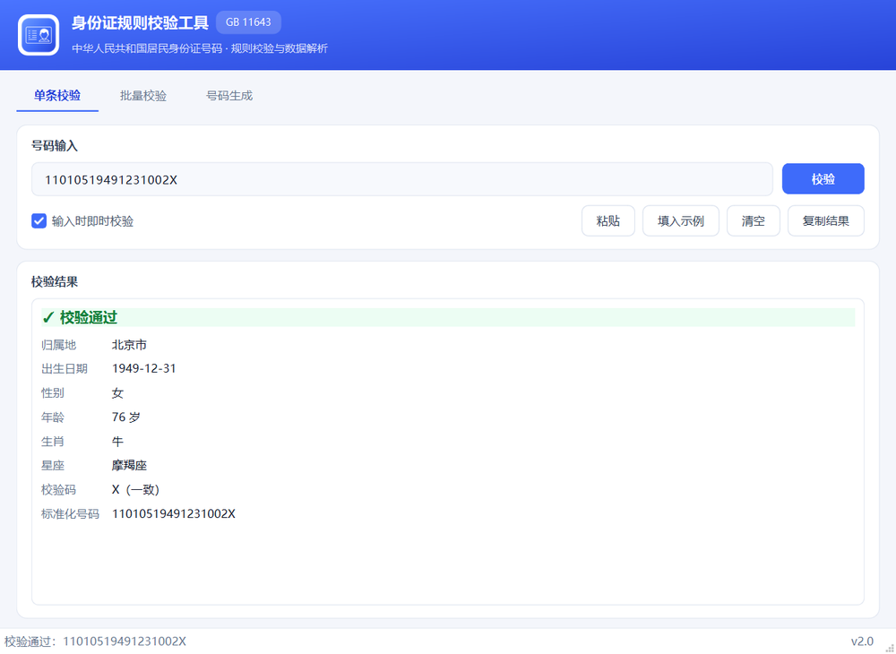
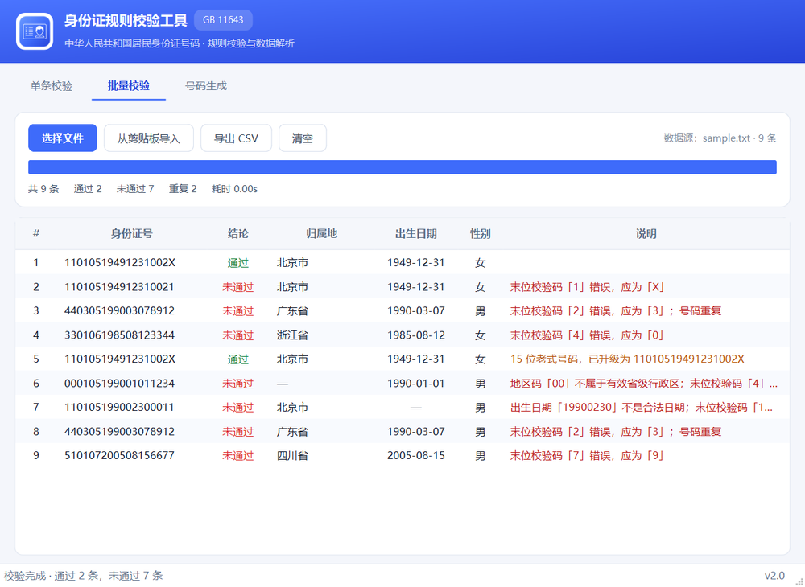
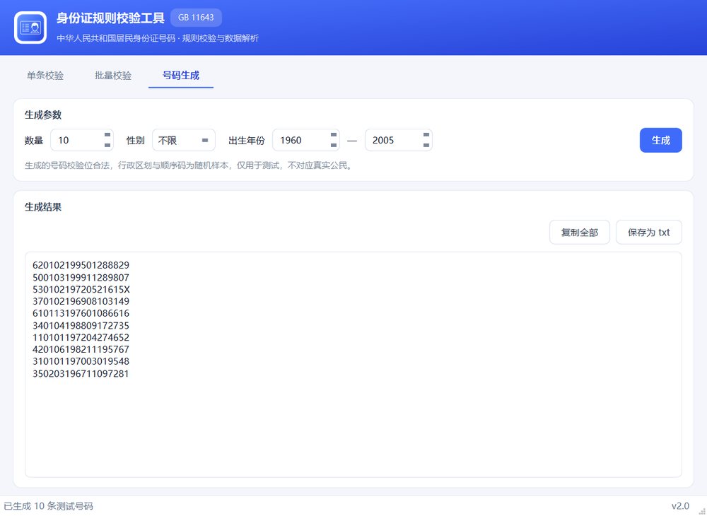

# 身份证规则校验工具 v2.0

基于 **PyQt6** 的桌面小工具，按 GB 11643 规则校验中国大陆居民身份证号码，并解析归属地、出生日期、性别、年龄等信息；支持单条校验、批量校验与测试号码生成。

---

## 项目预览

**单条校验**



**批量校验**



**号码生成**



---

## 一、v2.0 更新内容

| 项目 | v1.0 | v2.0 |
| --- | --- | --- |
| 界面 | 单页面、固定 600×400 | 三标签页、自适应布局、统一蓝色主题与自绘图标 |
| 校验规则 | 长度 / 数字 / 年份 / 日期 / 校验位 | 在原有基础上补充非法字符提示、地区码分段校验、未来日期、超龄提示 |
| 老式号码 | 不支持（15 位直接报长度错误） | 自动升级为 18 位并校验 |
| 结果展示 | 纯文本拼接 | 结论卡片 + 字段表（归属地 / 出生日期 / 性别 / 年龄 / 生肖 / 星座 / 校验码） |
| 批量 | 只支持 txt，文本流式输出，界面会卡住 | txt / csv / 剪贴板 / 拖拽导入，表格逐行展示，分块处理不卡界面，进度条 + 统计 + 重复检测 + 导出 CSV |
| 新增能力 | — | 测试号码生成（可指定性别与年份区间）、结果复制、快捷键、窗口与任务栏图标 |
| 图标 | 无 | 全尺寸 ICO（16–256 px）与窗口 / 任务栏图标 |

## 二、运行环境

- 操作系统：Windows 10 / 11
- Python：3.10+（开发环境 3.13）
- 依赖：`PyQt6`

```bash
pip install PyQt6
```

## 三、源码运行

```bash
cd 005一款身份证规则校验小工具
python "一款身份证规则校验小工具.py"
```

## 四、打包方法

图标与勾选标记随程序一起打包，务必带上 `--add-data` 与 `--icon`：

```bash
cd 005一款身份证规则校验小工具
python -m PyInstaller --noconfirm --clean --noconsole --onefile ^
  --name "一款身份证规则校验小工具" ^
  --icon "assets\icon.ico" ^
  --add-data "assets;assets" ^
  "一款身份证规则校验小工具.py"
```

产物：`dist\一款身份证规则校验小工具.exe`，双击即可运行，无需安装 Python。

## 五、功能说明

### 1. 单条校验

- 输入 18 位号码（末位支持 X / x），回车或点“校验”即可；也可开启“输入时即时校验”。
- 支持粘贴、填入示例、复制结果、清空。
- 校验项：
  - 长度必须为 18 位（15 位老号自动升级校验）
  - 仅允许 `0-9` 与末位 `X`，其余字符直接报错
  - 前 17 位必须为数字
  - 第 1–2 位必须是有效省级行政区划代码，第 3–4 位不得为 `00`
  - 出生日期必须真实存在（如 2 月 30 日会被拒绝），年份不早于 1900，且不晚于今天
  - 末位校验码按 ISO 7064:1983 MOD 11-2 复算比对
- 通过后展示：归属地、出生日期、性别、年龄、生肖、星座、校验码、标准化号码。

### 2. 批量校验

- 支持选择文件、从剪贴板导入，或直接把 `.txt` / `.csv` 拖进窗口。
- 文件格式：每行一个号码，也可用逗号、分号、制表符分隔；表头等中文行会自动跳过；编码自动识别（UTF-8 / GB18030 / UTF-16）。
- 结果表格列：# / 身份证号 / 结论 / 归属地 / 出生日期 / 性别 / 说明，未通过原因以红字标注。
- 统计：总数、通过、未通过、重复条数、耗时；重复号码会在说明列标注。
- 导出 CSV（UTF-8 BOM，Excel 直接打开不乱码）。
- 双击任意一行，可把该号码带回单条校验页查看详情。
- 分块处理（每批 250 条），5000 条约 0.4 秒完成，界面不冻结。

### 3. 号码生成

- 设定数量、性别、出生年份区间，生成校验位合法的测试号码。
- 结果可复制或保存为 txt。
- 号码中的行政区划与顺序码为随机样本，**不对应任何真实公民**。

### 快捷键

| 快捷键 | 功能 |
| --- | --- |
| `Enter` | 单条校验 |
| `Ctrl + Enter` | 单条校验 |
| `Ctrl + O` | 打开批量文件 |
| `Ctrl + E` | 导出批量结果 |

## 六、项目结构

```
005一款身份证规则校验小工具/
├── 一款身份证规则校验小工具.py   # 全部逻辑（校验核心 + 界面）
├── assets/
│   ├── icon.ico                 # 多尺寸应用图标（16–256 px）
│   ├── icon.png                 # 512 px 预览图
│   ├── icon_256.png             # 256 px 预览图
│   ├── icon_source.svg          # 图标源文件
│   └── check.svg                # 复选框勾选标记
├── images/                      # 文档预览图
├── dist/                        # 打包产物
└── README.md
```

代码分两层：`validate_id()` 等纯函数负责规则计算（不依赖界面，可单独测试），`IDValidatorWindow` 只负责交互与展示。

## 七、注意事项

- 本工具仅做**规则校验**，不访问公安或任何权威数据库，不能作为身份证真伪的鉴定依据。
- 归属地仅按前两位省级行政区划代码识别，历史或特殊地区可能无法细分到市县级。
- 校验结果涉及个人信息，请勿将导出的 CSV 用于未经授权的用途。
