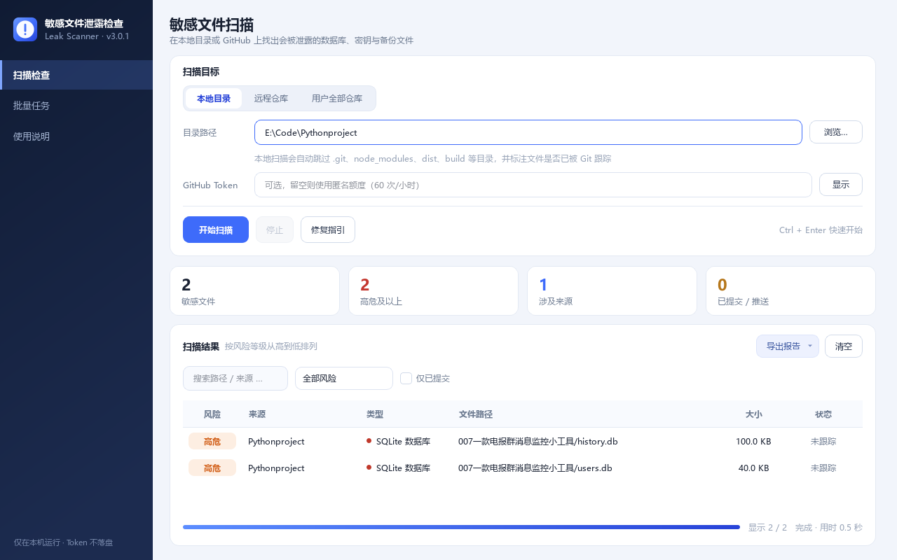
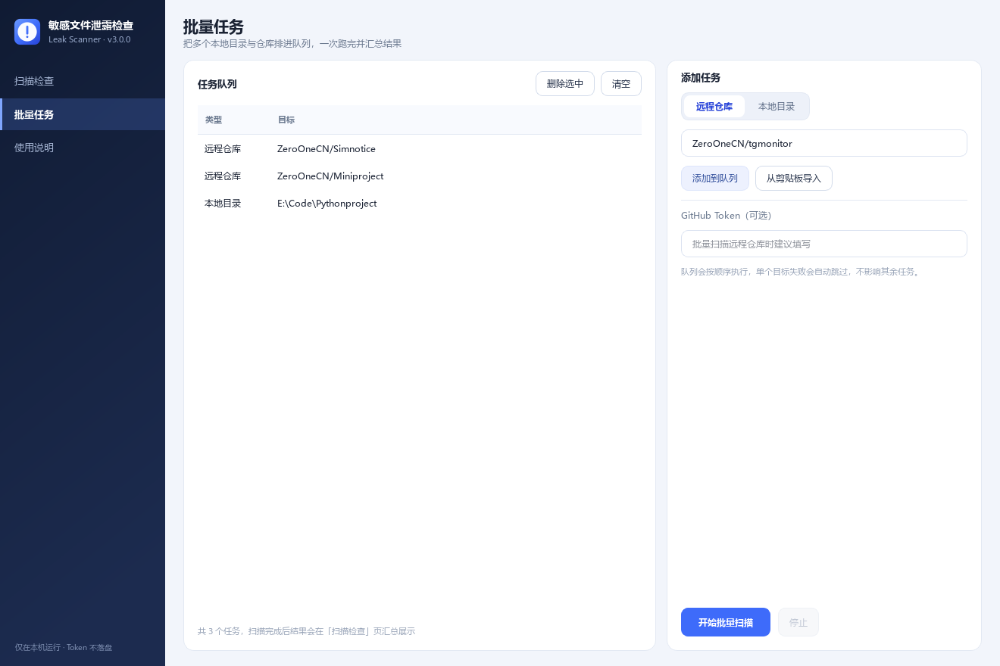
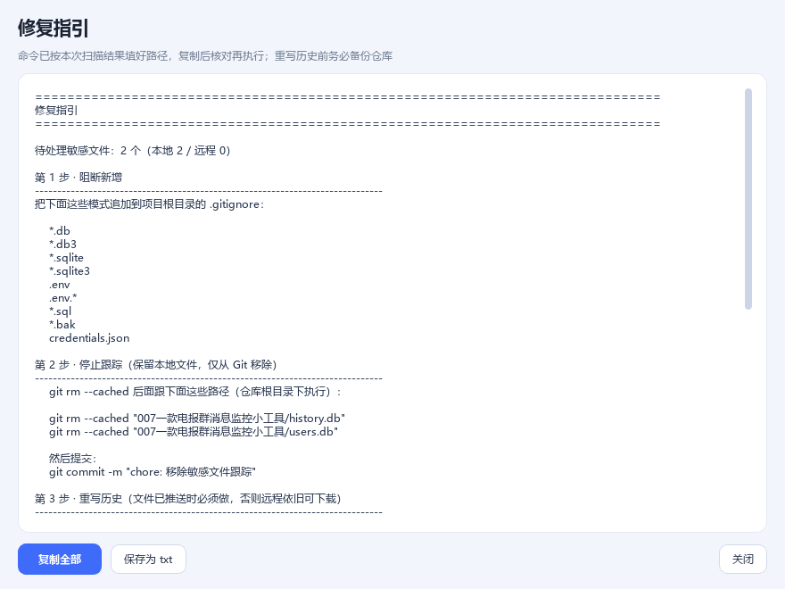

# GitHub 仓库敏感文件检查工具 v3.0

> 一款用来找出「不该提交却提交了」的文件的小工具：数据库文件、`.env`、私钥、备份包。
> 支持本地目录、远程仓库、整用户批量扫描，结果按风险分级并直接给出可执行的清理命令。


---

## 界面预览

**扫描检查** — 一次扫描本地目录或远程仓库，结果按风险排序，支持排序、筛选与导出



**批量任务** — 把多个本地目录与仓库排进队列一次跑完，可从剪贴板批量导入



**修复指引** — 按本次结果自动填好路径的命令清单，复制即用



---

## 一、v3.0 更新内容

| 维度 | v2.x（Tkinter 单文件） | v3.0（PyQt6 分层） |
| --- | --- | --- |
| 架构 | 1900 行单文件，逻辑与界面互相调用 | `core`（纯逻辑，零 GUI 依赖）+ `ui`（PyQt6），入口薄到 20 行 |
| 界面 | ttk 默认控件，两个页签 + 一张共用表格 | 左侧导航 + 卡片式布局 + 统计卡 + 风险徽章表格 + 轻提示（Toast） |
| 主题 | 系统默认灰白 | 统一品牌蓝调色板，集中在 `ui/theme.py`，全局 QSS |
| 图标 | 无 | 全新应用图标（矢量 SVG → 16–256 px 多尺寸 ICO），窗口 / 任务栏 / exe 全部生效 |
| 本地扫描性能 | 每个命中文件跑 2 次 `git` 子进程，几百个文件就卡 | 整仓库 1 次 `git ls-files` + 1 次 `git check-ignore --stdin` |
| 远程扫描 | 每个文件串行请求 contents API 取大小 | raw `HEAD` 取大小（不消耗 API 配额）+ 6 线程并发 |
| 错误处理 | 403/404 只打一行进度就返回空列表 | 统一客户端，区分限流 / 无权限 / 网络异常，错误直达界面 |
| 风险判定 | 界面与报告各写一套，结论会打架 | 单一 `assess_risk()`，界面、TXT、JSON、CSV 共用；新增 `secret` 类型 |
| 结果表 | 固定列，不能排序筛选 | 点表头排序、关键字搜索、按风险过滤、仅看已提交 |
| 报告 | 只有 TXT 内容较全 | TXT / JSON / CSV 三格式共享同一份数据模型，JSON 带统计摘要 |
| 修复指引 | 固定模板，路径要自己改 | 按命中文件生成 `git rm --cached`、`git filter-repo`、BFG 命令 |
| 可测试性 | 无 | 核心层 10 项单元测试，可脱离界面运行 |

---

## 二、运行环境

- Windows 10 / 11
- Python 3.10+（开发环境 3.13）
- 依赖：`PyQt6`、`requests`

```bash
pip install -r requirements.txt
```

---

## 三、快速开始

### 源码运行

```bash
cd 006一款敏感文件检查的小工具
python "一款敏感文件检查的小工具.py"
```

也可以用模块方式启动：

```bash
python -m leakscanner
```

### 打包成单文件 exe

```bash
cd 006一款敏感文件检查的小工具
python -m PyInstaller --noconfirm --clean --noconsole --onefile ^
  --name "一款敏感文件检查的小工具" ^
  --icon "assets\icon.ico" ^
  --add-data "assets;assets" ^
  "一款敏感文件检查的小工具.py"
```

产物：`dist\一款敏感文件检查的小工具.exe`，约 39 MB，双击即可运行，无需安装 Python。

> `--add-data` 与 `--icon` 都不能省：图标资源同时用于窗口、任务栏和 exe 文件本身。
> `dist/`、`build/`、`*.spec` 已在 `.gitignore` 中排除，不会进入版本库。

---

## 四、功能说明

### 1. 三种扫描模式

| 模式 | 输入 | 说明 |
| --- | --- | --- |
| 本地目录 | 目录路径 | 遍历目录并标注每个文件是否已被 Git 跟踪；自动跳过 `.git`、`node_modules`、`dist`、`build` 等 |
| 远程仓库 | `owner/repo`、仓库链接、`git@` SSH 地址 | 读取默认分支的完整文件树，私有仓库需 Token |
| 用户全部仓库 | 用户名或主页链接 | 逐个扫描该用户名下的公开仓库，单个仓库失败自动跳过 |

### 2. 批量任务

- 右侧添加任务，或「从剪贴板导入」一次性粘贴多行地址（自动区分仓库与本地路径）
- 队列按顺序执行，扫描完成后自动跳回「扫描检查」页汇总展示
- 队列里单个目标出错只记一条提示，不中断整批

### 3. 结果表

| 操作 | 效果 |
| --- | --- |
| 单击表头 | 按该列排序，再点一次反向 |
| 搜索框 | 按路径 / 来源 / 类型 / 风险原因过滤 |
| 风险下拉 | 全部 / 仅严重 / 高危及以上 / 中危及以上 |
| 勾选「仅已提交」 | 只留已经进入 Git 的文件 |
| 双击行 | 远程文件在浏览器打开，本地文件打开所在文件夹 |
| 右键 | 复制链接、复制路径、复制风险说明、打开修复指引 |
| Ctrl + Enter | 在当前模式下快速开始扫描 |

### 4. 报告导出

一次扫描结果可导出三种格式，内容同源：

- **TXT**：分组清单 + 风险统计 + 修复建议，适合直接贴给同事
- **JSON**：带 `summary` 统计与完整字段，适合接 CI 或二次处理
- **CSV**：一行一个文件，带 BOM，Excel 打开不乱码

### 5. 修复指引

点「修复指引」会按当前结果生成一份命令清单，路径已经填好：

1. 阻断新增：`.gitignore` 模板
2. 停止跟踪：逐条 `git rm --cached <路径>`
3. 重写历史：`git filter-repo` 逐条命令 + BFG 方案 + 强推命令
4. 善后：轮换凭证、开启 Secret Scanning、gitleaks 钩子配置

> 重写历史会改变所有提交哈希，操作前请备份仓库；已有 Fork 需要单独处理。

---

## 五、检测规则与风险判定

### 检测范围

| 类型 | 匹配规则 |
| --- | --- |
| SQLite 数据库 | `.db` `.db3` `.sqlite` `.sqlite3` `.sqlite2` |
| MySQL / SQL 脚本 | `.sql` `.mysqldump` `.sql.gz` |
| PostgreSQL 相关 | `.pgpass` `.psql_history` `.pgdump` |
| Access 数据库 | `.accdb` `.mdb` |
| 凭证 / 密钥 | `.env` `.env.*` `credentials.json` `secrets.json` `id_rsa` 等私钥、`.pem` `.pfx` `.p12` `.keystore` `.jks` `.npmrc` `.pypirc` `.netrc` |
| 备份 / 配置数据 | `.bak` `.backup` `database.json` `data.json` `db_config.json` `.dump` |

### 风险等级

| 等级 | 典型对象 | 判定要点 |
| --- | --- | --- |
| 严重 | 凭证、密钥、`.env`、`credentials.json` | 泄露等同于交出口令 |
| 高危 | 二进制数据库（`.db` `.sqlite` `.mdb`）、Access、SQL 转储、文件名含 `user` / `account` | 通常含真实业务数据 |
| 中危 | 普通 `.sql` 脚本、`.bak` / `.backup` | 可能暴露结构或残留数据 |
| 低危 | `schema.sql` 之类纯结构文件 | 一般不含真实数据 |

判定逻辑集中在 `leakscanner/core/rules.py` 的 `assess_risk()`，界面标签、表格颜色、三种报告格式都取自这同一份结论。

---

## 六、目录结构

```
006一款敏感文件检查的小工具/
├── 一款敏感文件检查的小工具.py      # 入口（20 行，只负责启动）
├── leakscanner/
│   ├── core/                        # 纯逻辑层，不 import 任何 Qt
│   │   ├── rules.py                 # 文件模式、类型元数据、风险判定
│   │   ├── models.py                # ScanItem / ScanResult / ScanTask / ScanRequest
│   │   ├── gitutil.py               # Git 跟踪与忽略状态（批量查询）
│   │   ├── github.py                # GitHub API 客户端（重试 / 限流 / 错误语义）
│   │   ├── engine.py                # 四种扫描方式 + 取消令牌
│   │   └── report.py                # TXT / JSON / CSV 与修复指引
│   └── ui/                          # PyQt6 界面层
│       ├── theme.py                 # 调色板 + 全局 QSS + 图标加载
│       ├── widgets.py               # 卡片、统计卡、分段控件、徽章、Toast
│       ├── results_panel.py         # 统计 + 筛选 + 表格 + 导出
│       ├── pages.py                 # 扫描检查 / 批量任务 / 使用说明
│       ├── dialogs.py               # 修复指引对话框
│       ├── main_window.py           # 导航 + 扫描线程调度
│       └── app.py                   # QApplication 启动
├── assets/                          # icon.svg（源）/ icon.ico / icon.png
├── images/                          # README 截图
├── tests/test_core.py               # 核心层单元测试
├── tools/build_icons.py             # SVG → 多尺寸 ICO
├── tools/screenshot.py              # 离屏渲染截图
├── bfg.jar                          # BFG Repo-Cleaner（清理历史用）
├── GitHub敏感文件清理教程.md         # 手把手清理教程
├── requirements.txt
└── README.md
```

分层约定：`core` 不依赖 Qt，`ui` 不写业务判断。想加一种检测规则或报告格式，只改 `core`；想改配色或布局，只改 `ui`。

---

## 七、开发与测试

```bash
# 核心层单元测试（不需要图形界面）
python tests/test_core.py

# 重新生成图标（改 assets/icon.svg 后执行）
python tools/build_icons.py

# 重新生成 README 截图
python tools/screenshot.py
```

测试覆盖：文件模式识别、风险分级、仓库地址解析、本地扫描、目录排除、取消扫描、Git 状态查询、三种报告输出。

---

## 八、GitHub Token 配置

Token 只保存在进程内存里，不写盘、不上传。匿名访问限额 60 次/小时，带 Token 提升到 5000 次/小时，并且能读私有仓库。

推荐使用 Fine-grained token，权限最小化：

| 项目 | 建议 |
| --- | --- |
| Token name | `leak-scanner` |
| Expiration | 30 或 90 天 |
| Repository access | Only select repositories（只勾要扫的） |
| Permissions | **Contents: Read-only**、**Metadata: Read-only** |

生成路径：`Settings → Developer settings → Personal access tokens → Fine-grained tokens`。

---

## 九、常见问题

**Q：提示 API 配额用尽怎么办？**
填 Token；或者等限流窗口重置（界面会给出重置时间）。

**Q：私有仓库显示「不存在或无权访问」？**
Fine-grained token 需要把目标仓库加入 `Repository access` 白名单，且 `Contents` 至少 Read-only。

**Q：本地目录扫出来全是「未跟踪」，是不是没生效？**
说明该目录不在 Git 工作区内，或者这些文件确实没被跟踪——这正是「还没泄露」的好状态；如果状态是「已跟踪」，才是需要处理的问题。

**Q：仓库很大，结果不全？**
GitHub 的文件树接口对超大仓库会截断（约 10 万条目），界面会给出提示。这种情况建议本地克隆后扫描本地目录。

**Q：扫描会不会上传我的文件？**
不会。本地扫描只读文件名、大小和 Git 状态；远程扫描只读取文件列表与大小，不下载文件内容。

---

## 十、相关文档

- [GitHub 敏感文件清理教程](./GitHub敏感文件清理教程.md) —— 从发现到强推的完整流程
- 仓库内的 `bfg.jar` 可直接用于清理 Git 历史
